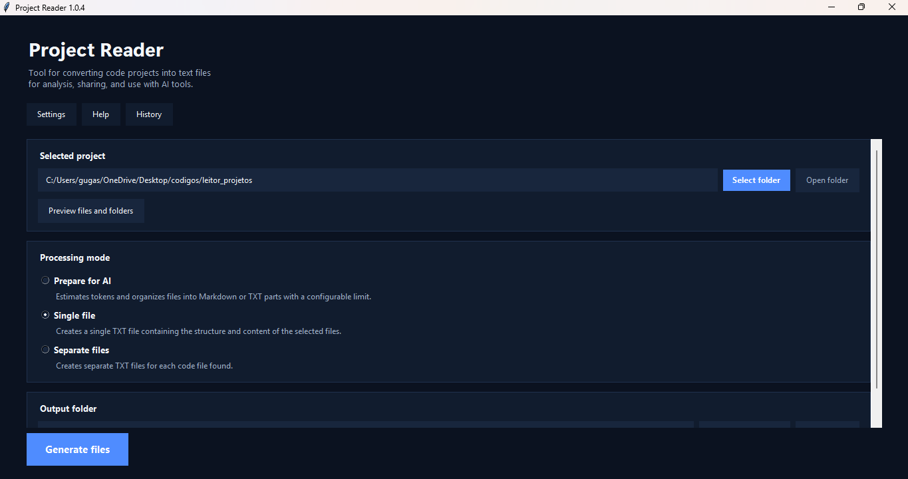
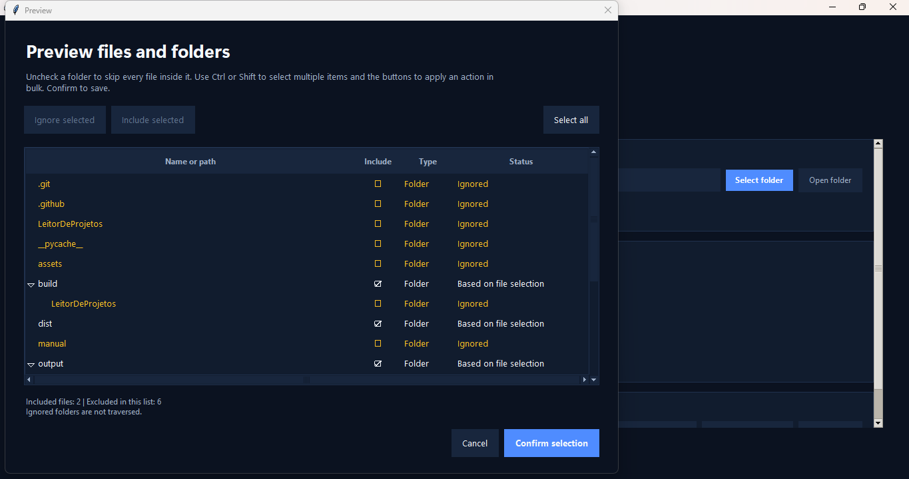
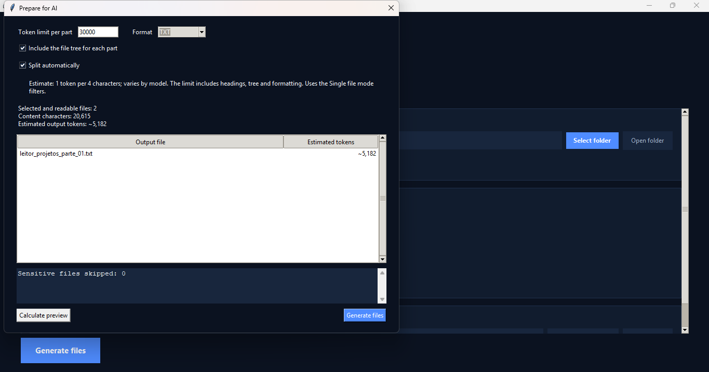

# Project Reader


[Instalador para Windows](https://github.com/ink-creator/Leitor-de-projetos/releases/latest) · [Vídeo de demonstração](assets/demo/project-reader-demo.mp4) · [English](README.md)

Transforme projetos de código-fonte em arquivos de texto ou Markdown organizados para análise, documentação, compartilhamento e uso com ferramentas de IA.



## Demonstração

[](assets/demo/project-reader-demo.mp4)

[Assistir ou baixar o vídeo de demonstração](assets/demo/project-reader-demo.mp4)

## Funcionalidades

- Selecione projetos de código locais através de uma interface desktop.
- Pré-visualize arquivos e pastas antes de gerar a saída.
- Inclua ou ignore arquivos, pastas e extensões específicas.
- Gere um único arquivo combinado ou arquivos separados.
- Prepare projetos para IA usando limites configuráveis de tokens.
- Divida projetos grandes automaticamente em várias partes.
- Exporte conteúdo preparado para IA em Markdown ou TXT.
- Inclua a árvore de arquivos do projeto nas partes geradas.
- Estime o tamanho da saída antes da exportação.
- Salve preferências localmente.
- Consulte operações anteriores através da área de Histórico.
- Ignore arquivos bloqueados ou sensíveis.
- Execute todo o fluxo localmente, sem precisar de chave de API.

### Visão Geral

A interface principal reúne seleção do projeto, modos de processamento, pasta de saída, configurações, ajuda e histórico em um único lugar.

Existem três modos de processamento:

- **Preparar para IA** — organiza o projeto em uma ou mais partes Markdown ou TXT respeitando um limite de tokens.
- **Arquivo único** — reúne o projeto selecionado em um único arquivo de texto organizado.
- **Arquivos separados** — cria saídas individuais para os arquivos selecionados.


### Pré-visualização de Arquivos e Pastas

Antes de gerar a saída, o Project Reader pode mostrar a estrutura detectada e permitir que você decida exatamente o que será incluído.

Pastas inteiras podem ser ignoradas de uma vez, vários itens podem ser selecionados com `Ctrl` ou `Shift`, e as regras salvas são reutilizadas pelos modos de processamento.



### Preparar para IA

O modo **Preparar para IA** foi criado para facilitar o envio de projetos maiores para ferramentas de inteligência artificial sem precisar copiar arquivo por arquivo.

Você pode definir:

- Limite de tokens por parte
- Formato de saída: Markdown ou TXT
- Se cada parte deve incluir sua árvore de arquivos
- Se o projeto deve ser dividido automaticamente

A prévia estima o tamanho da saída antes da geração e mostra quantas partes serão criadas.



## Modos de Processamento

### Preparar para IA

O Project Reader estima o tamanho da saída usando aproximadamente **1 token a cada 4 caracteres**. Essa é apenas uma estimativa; a contagem real varia entre modelos.

Os arquivos são mantidos inteiros sempre que couberem no limite configurado. Quando necessário, arquivos maiores podem ser divididos em trechos identificados para manter a saída dentro do tamanho escolhido.

Exemplo:

```text
Projeto
   ↓
Project Reader
   ↓
projeto_parte_01.md
projeto_parte_02.md
projeto_parte_03.md
   ↓
Ferramenta de IA
```

### Arquivo Único

Reúne a estrutura do projeto e o conteúdo legível dos arquivos selecionados em uma única saída.

```text
Projeto
├── index.html
├── style.css
└── script.js

        ↓

projeto.txt
```

### Arquivos Separados

Cria arquivos de texto individuais para os arquivos selecionados.

```text
index.html
style.css
script.js

    ↓

index.txt
style.txt
script.txt
```

## Filtros e Preferências

O Project Reader pode armazenar localmente preferências de processamento e regras de filtragem.

É possível configurar:

- Extensões que devem ser processadas
- Extensões que devem ser ignoradas
- Pastas ignoradas
- Arquivos específicos ignorados
- Regras de caminho relativo
- Opções de processamento
- Último projeto e preferências da interface

Conteúdos gerados como dependências, caches, builds e pastas temporárias podem ser excluídos do processamento.

## Segurança

Os arquivos gerados podem conter informações presentes no projeto selecionado.

Antes de compartilhar a saída com outra pessoa, serviço ou ferramenta de IA, revise o conteúdo em busca de informações sensíveis, como:

- Senhas
- Chaves de API
- Tokens de acesso
- Credenciais
- Chaves privadas
- Informações pessoais
- Configurações de ambiente
- Dados de conexão com bancos

O Project Reader ignora arquivos sensíveis bloqueados quando aplicável, mas o conteúdo gerado ainda deve ser revisado antes de ser compartilhado.

## Instalador para Windows

Uma versão compilada para Windows está disponível através do GitHub Releases.

[Baixar a versão mais recente para Windows](https://github.com/ink-creator/Leitor-de-projetos/releases/latest)

A versão atual é a **v1.0.4**, distribuída como `LeitorDeProjetos-1.0.4.exe`.

Quem utiliza o executável não precisa instalar Python.

> [!NOTE]
> O Windows pode exibir um aviso de editor desconhecido porque o executável não possui assinatura digital.

## Executando pelo Código-Fonte

Clone o repositório:

```bash
git clone https://github.com/ink-creator/Leitor-de-projetos.git
cd Leitor-de-projetos
```

Execute pela raiz do repositório:

```bash
python main.py
```

Ou execute diretamente o ponto de entrada da aplicação:

```bash
python LeitorDeProjetos/main.py
```

## Releases Automatizadas

O repositório possui um workflow do GitHub Actions para gerar e publicar o executável do Windows a partir de tags de release.

Exemplo:

```bash
git tag v1.0.4
git push origin v1.0.4
```

## Tecnologias

Python, Tkinter, configuração em JSON, APIs do sistema de arquivos, PyInstaller e GitHub Actions.

A aplicação funciona localmente e não precisa de navegador, servidor backend, chave de API ou serviço em nuvem para o fluxo principal.

<details>
<summary>Estrutura do Projeto</summary>

```text
Leitor-de-projetos/
├── .github/
│   └── workflows/
├── assets/
│   ├── demo/
│   │   └── project-reader-demo.mp4
│   └── screenshots/
│       ├── overview.png
│       ├── file-preview.png
│       └── ai-preparation.png
├── LeitorDeProjetos/
│   ├── configuracao/
│   ├── interface/
│   ├── processadores/
│   ├── utils/
│   ├── main.py
│   └── requirements.txt
├── manual/
├── tests/
├── main.py
├── LeitorDeProjetos.spec
├── README.md
├── README.pt-BR.md
└── LICENSE
```

</details>

## Licença

Distribuído sob a [Licença MIT](LICENSE).
