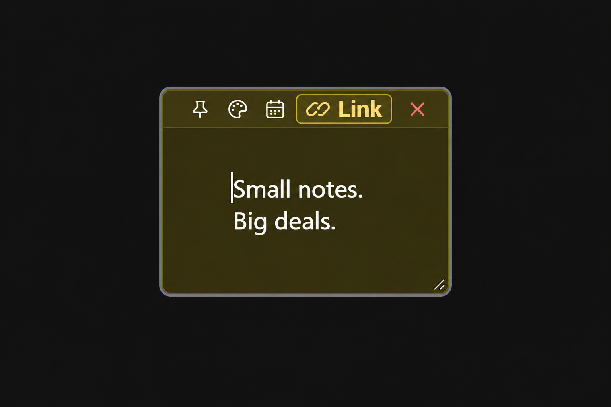
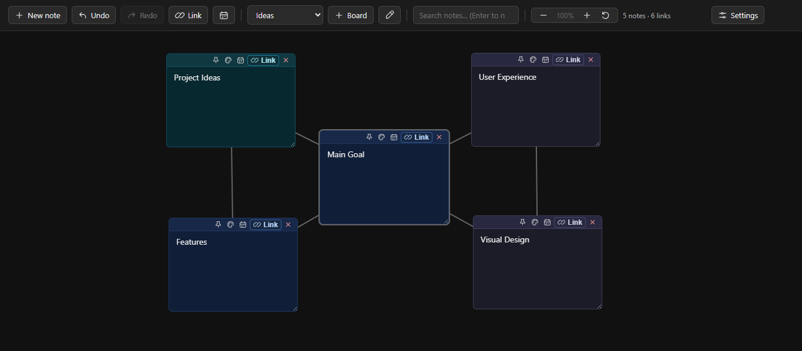
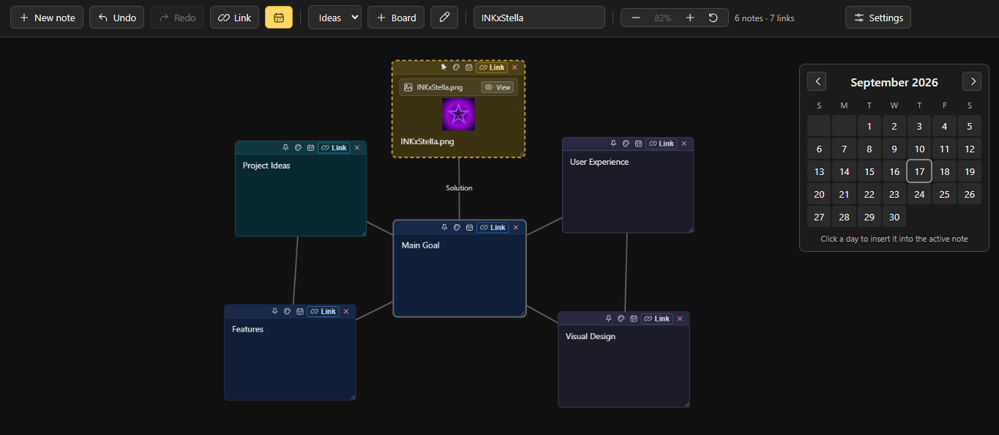
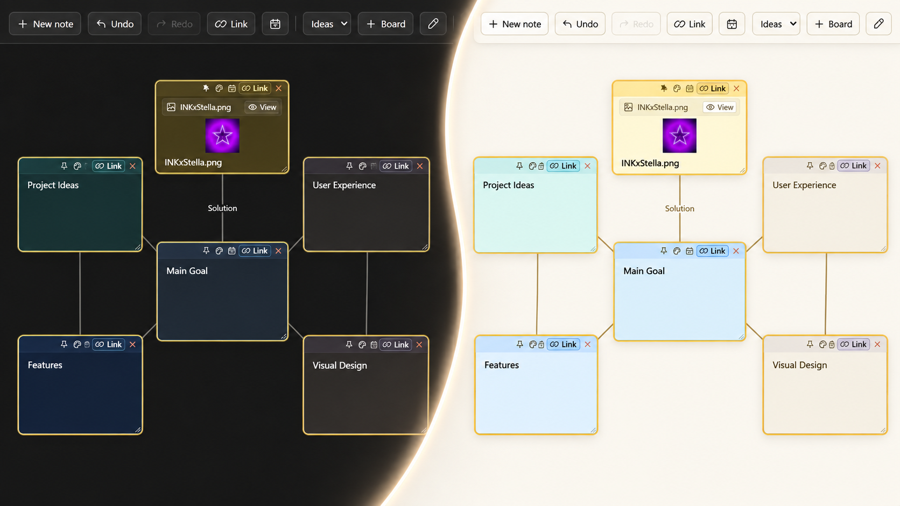

<p align="center">
  
</p>

# Notas Flutuantes


[Demonstração](https://ink-creator.github.io/Notas-flutuantes/) · [English](README.md)

Organize ideias em um quadro visual com notas flutuantes, ligações, arquivos e vários espaços de trabalho. Tudo funciona no navegador.



## Demonstração

[](assets/screenshots/floating-notes.mp4)

[Assistir ou baixar o vídeo de demonstração](assets/screenshots/floating-notes.mp4)

## Funcionalidades

- Crie, mova, redimensione, colora e fixe notas.
- Selecione e mova várias notas juntas; copie notas com suas ligações internas.
- Busque notas, navegue pelo quadro e ajuste o zoom.
- Desfaça e refaça alterações, use o calendário e troque o idioma da interface.
- Salve e restaure versões do espaço de trabalho nas configurações.

### Organização Visual

Ligue notas com linhas que podem receber nomes e distribua o conteúdo por quadros independentes. Dê dois cliques em uma área vazia para criar uma nota; use `Shift` para selecionar várias notas.

### Arquivos e Ferramentas de Produtividade

Arraste arquivos para o quadro e crie notas com anexos. Visualize imagens e documentos compatíveis, edite arquivos de texto no visualizador interno e adicione links da web ou caminhos locais. Busca, calendário e atalhos ajudam a navegar por quadros maiores.



### Temas Claro e Escuro

Alterne entre os temas claro e escuro nas configurações. A preferência fica salva neste navegador.



## Dados e Privacidade

Quadros, anexos e versões salvas ficam no navegador por meio do IndexedDB; as preferências usam o armazenamento local. O aplicativo não exige conta nem backend. Os dados pertencem a este navegador e dispositivo: exporte um backup antes de limpar os dados do navegador ou mudar de dispositivo.

## Backup e Restauração

Em **Configurações → Backup**, exporte todos os quadros ou apenas o atual em JSON. Importe uma exportação anterior para restaurar os dados. Os backups podem incluir notas, ligações, nomes dos quadros, imagens e arquivos anexados. As configurações também oferecem versões manuais e automáticas para recuperação.

## Atalhos de Teclado

Os atalhos funcionam fora dos campos de texto. No macOS, use `⌘` no lugar de `Ctrl`.

| Atalho | Ação |
| --- | --- |
| `L` | Ativar ou desativar o modo de ligação |
| `M` | Ativar ou desativar o modo de mover a nota ativa ou as selecionadas |
| `Setas` / `Shift + Setas` | Mover notas no modo de mover / mover mais rápido |
| `Delete` / `Backspace` | Excluir as notas selecionadas |
| `Ctrl + C` / `Ctrl + V` | Copiar / colar notas |
| `Ctrl + Z` | Desfazer |
| `Ctrl + Shift + Z` / `Ctrl + Y` | Refazer |
| `Esc` | Cancelar modos e fechar painéis |
| `Shift + arrastar` | Selecionar notas por área |
| `Shift + clique` | Adicionar ou remover uma nota da seleção |

## Executando Localmente

Baixe o repositório como ZIP ou clone-o, mantenha todos os arquivos do projeto juntos em uma pasta e dê dois cliques em `index.html` para usar o Notas Flutuantes no navegador. É recomendado colocar os arquivos em uma pasta própria para que os estilos e scripts sejam carregados corretamente.

Você também pode servir essa pasta em um servidor local estático:

```bash
git clone https://github.com/ink-creator/Notas-flutuantes.git
cd Notas-flutuantes
python -m http.server 8000
```

Depois, abra [http://localhost:8000](http://localhost:8000) no navegador.

## Tecnologias

HTML, CSS e JavaScript puro, com IndexedDB, armazenamento local e APIs de arquivos do navegador. O projeto não exige framework nem backend.

<details>
<summary>Estrutura do Projeto</summary>

```text
Notas-flutuantes/
├── assets/
│   └── screenshots/
│       ├── floating-notes.mp4
│       ├── logo.png
│       ├── overview-dark.webp.png
│       ├── themes.webp
│       └── tools.webp.png
├── README.md
├── README.pt-BR.md
├── LICENSE
├── index.html
├── style.css
├── icons.css
├── script.js
└── storage.js
```

</details>

## Licença

Distribuído sob a [Licença MIT](LICENSE).
